# Clinic Queue and Patient Management System

A console-based Java application that manages patient registration and consultation flow in a small clinic. It uses **manually implemented sorting algorithms** (Bubble, Insertion, and Selection Sort) to organize patient records and a **FIFO queue** (`Queue<Integer>` backed by `LinkedList`) to control the order in which patients are called.

> Capstone Project: Console-Based Java Application Using Sorting Algorithms and Queues
> Written in procedural Java: no custom classes, no OOP.

---

## Project Description

Clinics often face long waiting lines, disorganized patient information, and difficulty finding or ordering records. This application addresses those problems by:

- **Storing patient records** (name, age, symptoms, urgency, status) in a consistent, searchable format.
- **Managing the waiting line with a FIFO queue**, so patients are called in the order they were added. This keeps the process fair and predictable.
- **Sorting records on demand** by name, age, or urgency, so staff can view the data in whichever order is most useful, without disturbing the queue.
- **Calculating a triage hint** (HIGH / MEDIUM / LOW) from the selected symptoms and the patient's age, so staff can notify a doctor when a high-priority patient arrives.

> **Note:** The urgency level is a triage *hint* for staff, not a medical diagnosis. Patients who select the symptom **Other** are marked **REVIEW**, meaning an unlisted symptom requires manual staff assessment.

## Objectives

- Implement at least two sorting algorithms manually, without `Collections.sort()` or `Arrays.sort()`.
- Apply queue operations (enqueue, dequeue, peek, display, empty check) using the First-In, First-Out principle.
- Use parallel `ArrayList`s to store and manage patient records while keeping indexes synchronized.
- Apply loops, conditionals, methods, and input validation to build a menu-driven console program.
- Integrate the queue and sorting features into a single, realistic clinic workflow.
- Follow a procedural programming approach (static methods only, no custom classes).

## Use Cases and Features

The program is menu-driven with 16 options grouped into four sections.

### Patients

- **1. Register patient**: Enter a name, age, and symptoms from a checklist. A unique patient ID (starting at 1001) and an urgency level are assigned automatically.
- **2. View all patients**: Displays every stored record in a formatted list.
- **3. Search patient**: Search by exact **ID** or by **name** (partial, case-insensitive match).
- **4. Update symptoms**: Change a patient's symptoms; urgency is recalculated automatically.
- **5. Delete treated patient**: Removes a record, but only if the patient's status is *Served*.

### Queue

- **6. Add patient to queue** (Enqueue): Adds the patient to the back of the consultation queue.
- **7. Call next patient** (Dequeue): Removes the patient at the front and marks them *Called*.
- **8. Complete consultation**: Staff confirms the consultation is finished; status becomes *Served*.
- **9. Peek next patient**: Shows who is at the front without removing them.
- **10. View queue**: Displays the whole queue from front to back.
- **11. Check if queue is empty**: Reports whether anyone is waiting.

### Sorting

- **12. Sort by name**: Uses Bubble Sort to sort by name, A to Z.
- **13. Sort by age**: Uses Insertion Sort to sort by age, youngest first.
- **14. Sort by urgency**: Uses Selection Sort to sort by urgency, highest first.

### History and Reports

- **15. Activity history**: Log of actions (registrations, queue operations, sorts, updates, deletions).
- **16. Reports and statistics**: Patient counts by status, priority breakdown, youngest/oldest/average age, and most common symptom.
- **0. Exit**: Closes the program properly.

### Patient Status Flow

```
Registered  -->  Waiting  -->  Called  -->  Served
 (option 1)     (option 6)    (option 7)   (option 8)
```

### Input Validation and Error Handling

- Menu choices must be whole numbers within range; anything else shows an error and asks again.
- Names cannot be empty; age must be from 0 to 120; IDs must be whole numbers.
- Symptom selection is validated before a record is saved.
- Helpful messages are shown for empty queues, empty record lists, missing IDs, duplicate queue entries, and operations that are not allowed (for example, deleting a patient who has not been served).
- The program never crashes on invalid input.

## Data Structure Explanation

### Parallel ArrayLists (record storage)

Each patient is stored across several `ArrayList`s. **The value at index `i` in every list belongs to the same patient.**

- `patientIds` (`ArrayList<Integer>`): Unique patient ID
- `patientNames` (`ArrayList<String>`): Full name
- `patientAgeMonths` (`ArrayList<Integer>`): Age in months (so babies sort correctly)
- `symptomTexts` (`ArrayList<String>`): Symptom summary, e.g. `"Fever, Cough, Headache"`
- `urgencyScores` (`ArrayList<Integer>`): Calculated urgency score
- `manualReviewFlags` (`ArrayList<Boolean>`): `true` if the symptom *Other* was selected (needs staff review)
- `statuses` (`ArrayList<String>`): Registered, Waiting, Called, or Served
- `activityLog` (`ArrayList<String>`): Activity history messages

To keep the lists synchronized:

- **Adding** a patient appends one value to every list.
- **Deleting** a patient removes the same index from every list.
- **Sorting** uses a `swapRecords(a, b)` helper that swaps *all* lists together, and the insertion sort shifts every list at the same time.

### Queue (consultation order)

```java
static Queue<Integer> consultationQueue = new LinkedList<>();
```

The queue stores **patient IDs**, not full records. This design is important:

- `add()` / `poll()` / `peek()` / `isEmpty()` provide enqueue, dequeue, peek, and empty-check operations.
- Because the queue holds IDs and each record is found with `findIndexById()`, **sorting the records never changes the order in which patients are called**. The screenshots under "Sorting" confirm this with the message *"Queue order was not changed."*
- High-priority patients only trigger a notice to staff; they do **not** jump the line, so strict FIFO is preserved.

### Other Data

- `SYMPTOM_NAMES[]` and `SYMPTOM_WEIGHTS[]` are parallel arrays describing the symptom checklist and how serious each symptom is.
- **Urgency score** = symptom weights + combination bonuses (for example, vomiting + diarrhea, or breathing difficulty + chest pain) + age factors (infants and elderly patients). A score of 8 or more is **HIGH**, 4 to 7 is **MEDIUM**, and below 4 is **LOW**.

## Sorting Algorithm Explanation

All three algorithms are written by hand using loops and comparisons. No built-in sorting methods are used. Each one rearranges the records **only**, never the queue, and shows the records before and after sorting.

### 1. Bubble Sort: Sort by Name (A to Z)

- **How it works:** Repeatedly compares neighboring names (ignoring case) and swaps them if they are out of order. After each pass, the largest remaining name "bubbles" to the end. An early exit (`swapped` flag) stops the loop once a pass makes no swaps.
- **Why it fits:** Clinic staff often need to look up a patient alphabetically. Bubble Sort is simple, easy to verify, and perfectly fast for a small clinic's list of records.

### 2. Insertion Sort: Sort by Age (youngest first)

- **How it works:** Takes each record in turn and inserts it into the correct position among the already-sorted records on its left, shifting older records to the right.
- **Why it fits:** It works well on lists that are partly ordered and when new patients are added one at a time. Age is stored in **months**, so an 11-month-old correctly sorts before an 8-year-old.

### 3. Selection Sort: Sort by Urgency (highest first)

- **How it works:** For each position, scans the unsorted part to find the most urgent record and swaps it into place.
- **Why it fits:** It makes few swaps and clearly shows "find the most urgent patient first," which matches how triage works. Patients marked **REVIEW** (unscored, unlisted symptoms) are grouped at the end instead of being ranked by a provisional score.

**Summary of the sorting algorithms:**

- **Bubble Sort** sorts by **name** (A to Z). Time: O(n) best case, O(n²) average and worst case.
- **Insertion Sort** sorts by **age in months** (youngest first). Time: O(n) best case, O(n²) average and worst case.
- **Selection Sort** sorts by **urgency score** (highest first). Time: O(n²) in all cases.

## How to Run the Program

### Requirements

- **Java JDK 14 or newer** (the program uses the modern `switch` arrow syntax).
- A terminal that supports ANSI colors (Windows Terminal, VS Code terminal, macOS Terminal, or most Linux terminals).

Check your Java version:

```bash
java -version
```

### Compile and Run

From the project root folder:

```bash
# 1. Compile
javac src/Main.java

# 2. Run
java -cp src Main
```

Or from inside the `src` folder:

```bash
cd src
javac Main.java
java Main
```

### Troubleshooting

- **Strange characters such as `[92m` appear instead of colors:** Open `Main.java` and change `USE_COLOR` from `true` to `false`, then recompile.
- **`class file has wrong version` or switch syntax errors:** Your JDK is too old. Install JDK 17 or newer.

## Screenshots of the System

All screenshots were taken from the running application.

### 1. Main Menu

The main menu groups the 16 options into Patients, Queue, Sorting, and History and Reports. The footer shows how many patients are waiting and how many records are stored.

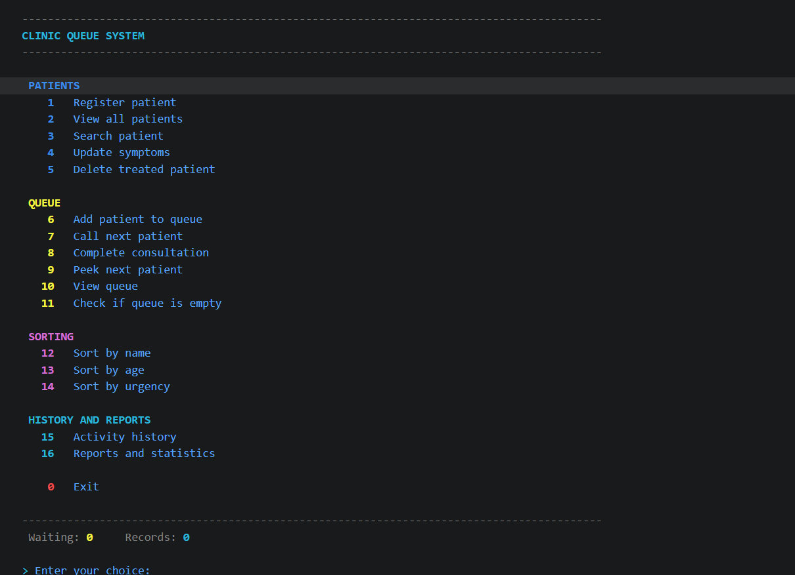

### 2. Adding Records and Displaying Stored Records

**Registering a patient:** the user enters a name, age, and symptom numbers. The system assigns an ID, lists the symptoms, and calculates the priority.

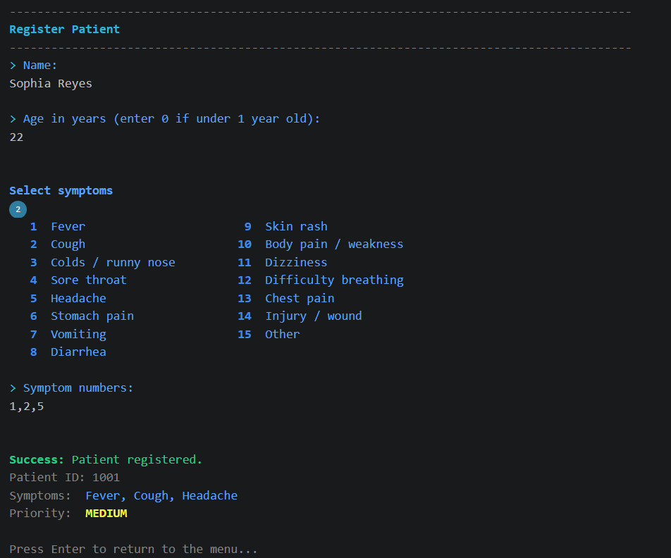

**Viewing all patients:** all stored records are shown in a list with ID, name, age, symptoms, status, and priority.

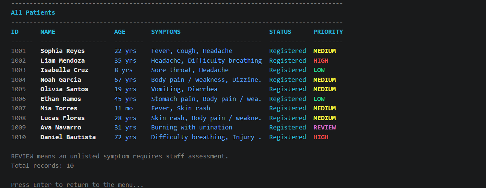

### 3. Search and Update

**Searching a patient by ID:** shows the patient's age, symptoms, priority, and status.

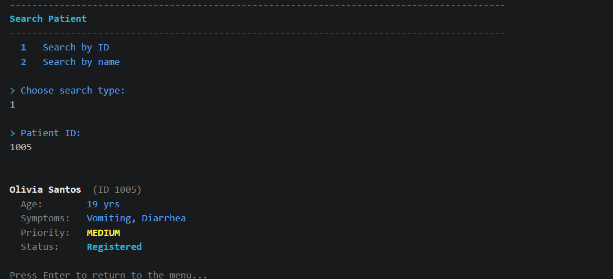

**Updating symptoms:** after the symptoms change (chest pain and diarrhea), the priority is recalculated to HIGH.

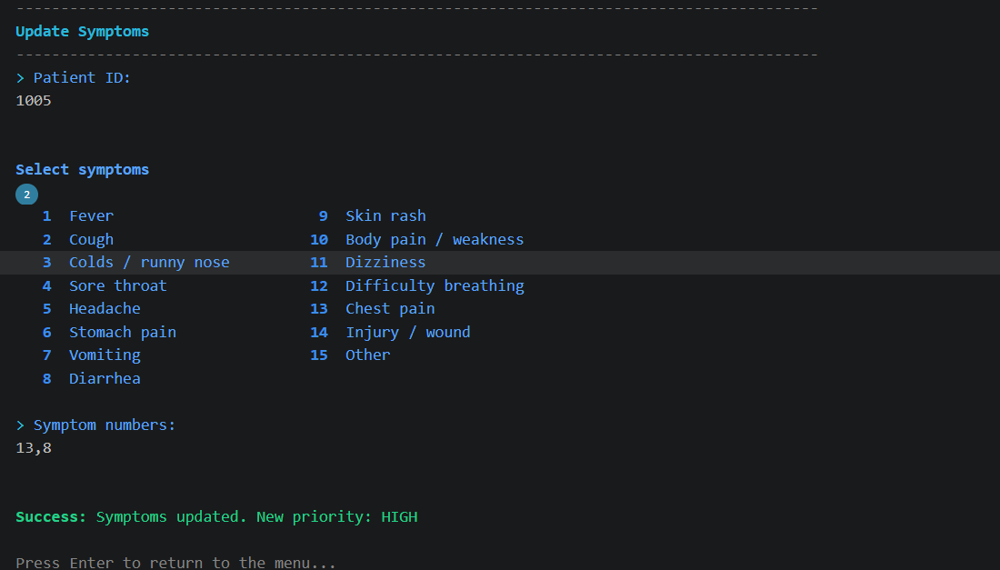

### 4. Queue Operations (Enqueue, Peek, Dequeue, Display)

Three patients are enqueued (option 6) in the order Sophia, Liam, Isabella. The queue is displayed (option 10), the front patient is peeked (option 9) without being removed, then dequeued (option 7). The queue is displayed again, showing the remaining patients.

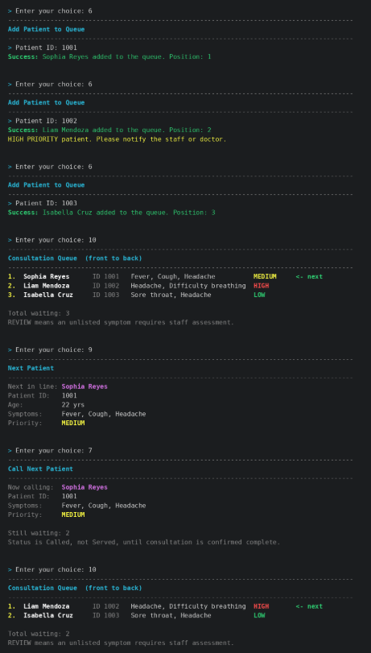

### 5. FIFO Behavior

**Before calling the next patient:** the queue holds five patients. Sophia Reyes was added first, so she is at the front (`<- next`).

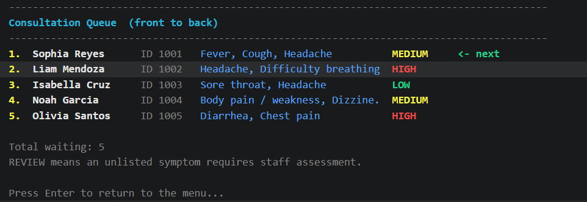

**After calling the next patient:** Sophia Reyes was removed first. Liam Mendoza, the second patient added, is now at the front, which shows that the first one in was the first one out.

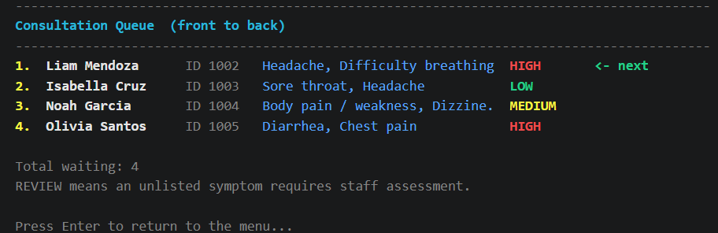

### 6. Sorting Algorithm 1: Bubble Sort (by Name)

Records before sorting are in arbitrary order; after sorting they are arranged alphabetically from A to Z.

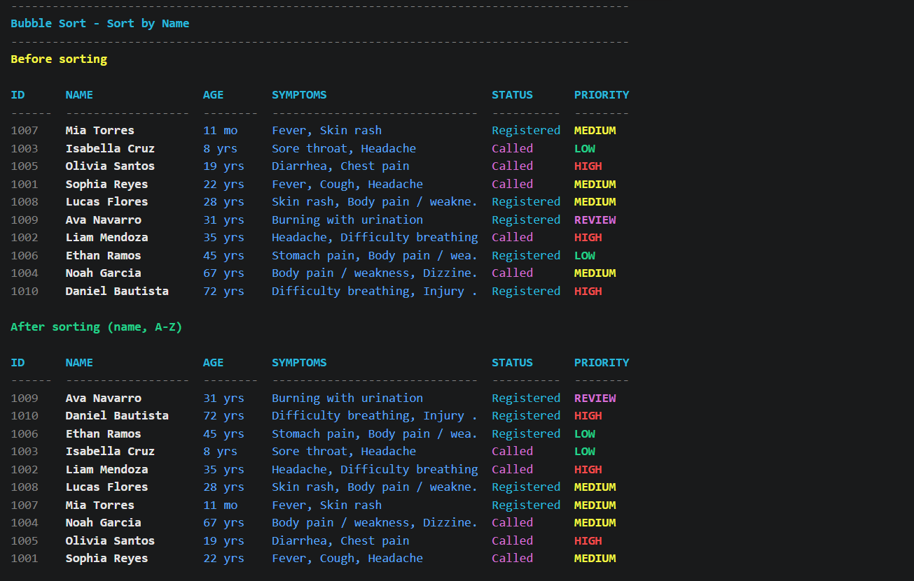

### 7. Sorting Algorithm 2: Insertion Sort (by Age)

Records are arranged from youngest (11 months) to oldest (72 years).

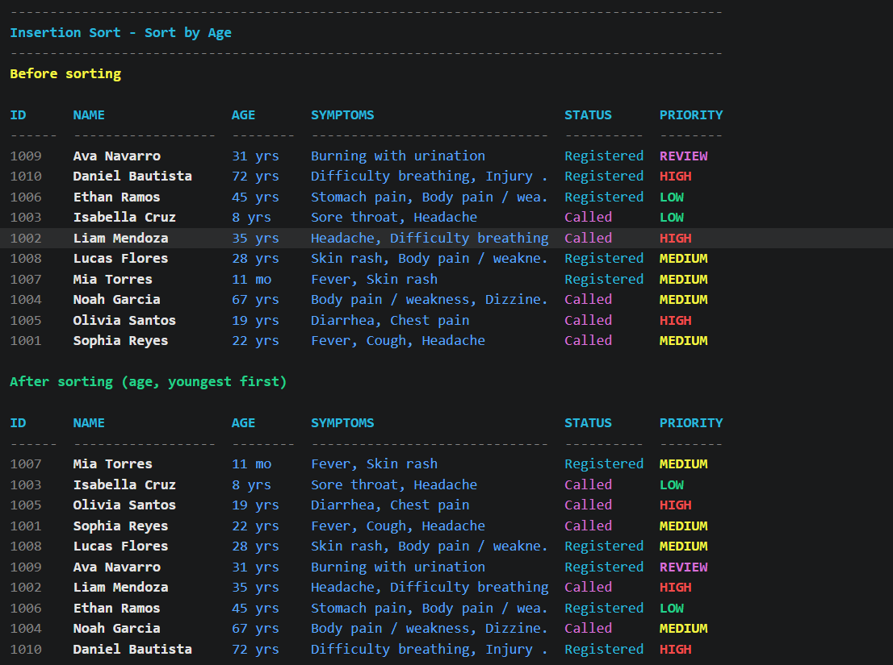

### 8. Sorting Algorithm 3: Selection Sort (by Urgency)

Records are arranged from HIGH to LOW priority, with REVIEW records placed last. The program confirms that the queue order was not changed.

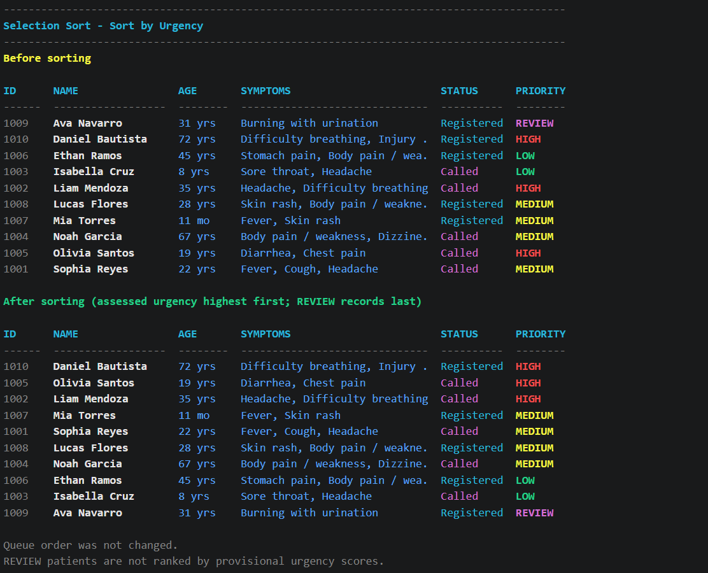

### 9. Input Validation and Error Messages

Entering `99` shows a range error and entering `abc` shows a "whole number" error. In both cases the program asks again instead of crashing.

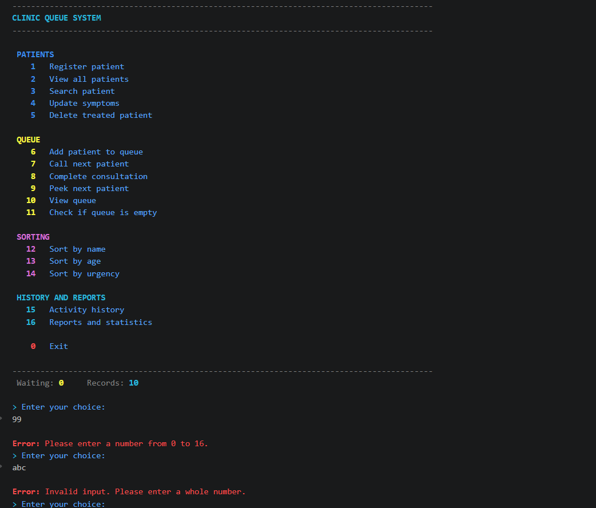

### 10. Reports and Statistics

Summary of patient statuses, priority counts, age statistics, and the most common symptom.

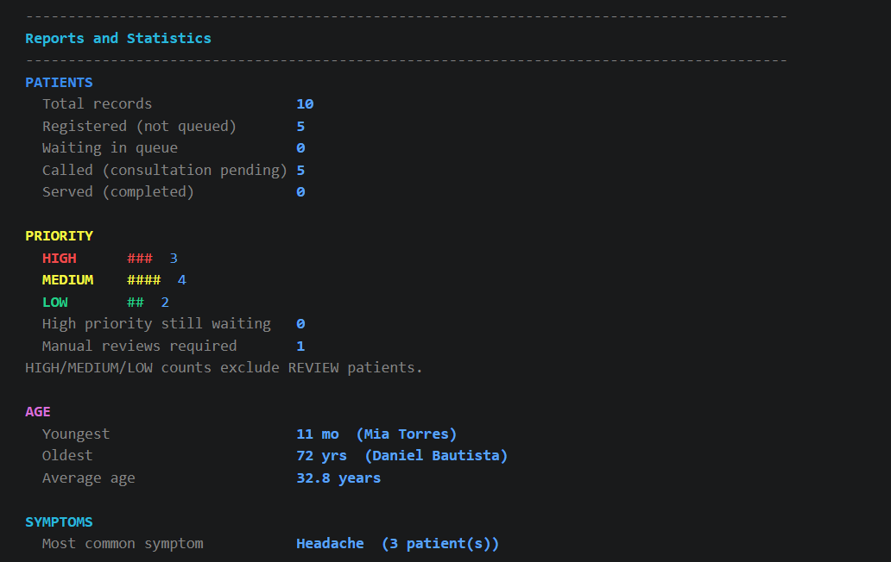

## Requirements Checklist

This section shows where each project requirement is met.

### Programming Requirements

- **Java, console-based, menu-driven:** The program runs in the terminal with a 16-option main menu plus Exit (option 0).
- **Invalid input handling:** Wrong menu choices, empty names, out-of-range ages, bad symptom numbers, and unknown IDs all show error messages and ask again. The program does not crash. (See screenshot 9.)
- **Manual sorting algorithms:** Bubble Sort (option 12), Insertion Sort (option 13), and Selection Sort (option 14) are written by hand. No `Collections.sort()`, `Arrays.sort()`, or other built-in sorting is used. Records are shown before and after sorting. (See screenshots 6 to 8.)
- **Queue using Java Collections:** `Queue<Integer>` backed by `LinkedList`, with enqueue (option 6), dequeue (option 7), peek (option 9), display (option 10), and empty check (option 11). (See screenshots 4 and 5.)
- **FIFO behavior:** The first patient added is the first patient called. (See screenshot 5.)
- **Queue has a real role:** A patient moves through Registered, Waiting, Called, and Served, and the queue controls the calling order. Sorting never changes that order.
- **Empty queue messages:** Peek, call next, view queue, and the empty check all show a clear message when no one is waiting.
- **ArrayLists for records:** Eight parallel `ArrayList`s keep their indexes synchronized for adding, displaying, searching, updating, deleting, and sorting.
- **No OOP:** The program has a single `Main` class with static methods only. There are no custom classes, objects, or inheritance.

### Minimum Functional Requirements

- **Main menu with clear options:** Yes, grouped into Patients, Queue, Sorting, and History and Reports.
- **Add and store records:** Option 1, Register patient.
- **Display stored records:** Option 2, View all patients.
- **Search:** Option 3, by ID or by name.
- **Queue and sorting in one workflow:** Yes. Records are registered, queued, called, and completed, and they can be sorted at any point.
- **Messages for empty lists, empty queues, missing records, and failed operations:** Yes.
- **Proper exit:** Option 0.

### Extra Features

- Update symptoms (option 4), delete treated patient (option 5), activity history (option 15), and reports and statistics (option 16).

## Repository Structure

```
DSA-Java-Sorting-Queue-Capstone/
├── src/
│   └── Main.java
├── screenshots/
│   ├── main-menu.png
│   ├── patient-registration.png
│   ├── patient-records.png
│   ├── searching-patient.png
│   ├── update-symptoms.png
│   ├── queue-operations.png
│   ├── fifo-before.png
│   ├── fifo-after.png
│   ├── bubble-sort.png
│   ├── insertion-sort.png
│   ├── selection-sort.png
│   ├── input-validation.png
│   └── reports-history.png
└── README.md
```

## Author

- **Name:** Marika M. Matsui
- **Course:** BSIT / IT2A
- **Instructor:** Miguel Edward Rosal